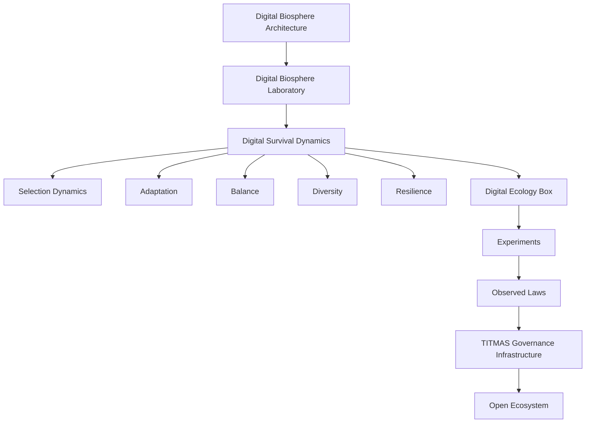

# ADR: Digital Biosphere Laboratory Charter v0.2

中文：数字生物圈实验室章程 v0.2。

## 1. Context（背景）

在已有研究内容的基础上，DBL 需处理一个结构性偏移：  
- `v0.1`：聚焦“Agent 如何选择目标/动作”  
- `v0.2`：升级为“数字智能生态在不确定环境下如何长期生存、适应与演化”

该升级将 DBA 从“行为决策解释”扩展为“生态长期稳定研究”。这是一条开放基础设施研究路线，不是 Agent 能力产品或执行系统建设。

现有约束（`selection != authorization`、`evidence != permission`、`recommendation != command`）保留不变；本次版本不改变 SAEE/DBOS/ TMAP 的现行权责写入边界。

## 2. Decision（决定）

发布 DBA 理论层 v0.2，核心框架为：

1. 以 `Digital Survival Dynamics`（数字生存动力学）作为生存结果导向的顶层研究问题；
2. 保留 `Selection Dynamics`（选择动力学）作为 `Digital Survival Dynamics` 的子机制；
3. 将 `Selection` 的输出定义为“有来源的生态选择证据”，而非授权或执行命令；
4. 调整 `Digital Ecology Box`（数字生态箱）为最小可复现实验单元；
5. 将 `Selection Dynamics` 与 TITMAS、DBOS、SAEE、EEOAP 的交互改写为边界映射，而非控制面。

## 3. Problem Statement（问题陈述）

- 进化问题并非“谁更强”，而是“谁在变化环境下更容易持续存在”。
- 仅优化选择精度会放大短期收益，但可能引发资源集中、脆弱化和生态崩溃。
- 数字生态研究要解释长期行为质量，需要同时观察：
  - Adaptation（适应）
  - Balance（平衡）
  - Diversity（多样性）
  - Resilience（韧性）

## 4. Core Invariants（核心不变量）

```text
SELECTION_OUTCOME != AUTHORIZATION
SELECTION_SCORE != TRUST
DECISION_EVIDENCE != EXECUTION_PERMISSION
RECOMMENDATION != COMMAND
SURVIVAL_ANALYSIS != POLICY_CONTROL
```

## 5. Mission（使命）

DBL v0.2 的任务是为“数字智能生态长期存在问题”建立可复现实验、可对比指标与可追踪证据模型，支持社区开展长期比较研究。

- 不做：定义并授权执行机制、替代治理系统、应用发布决策；
- 不承诺：安全、合规、商业成功、生产可用性；
- 产出：理论框架、实验规范、可复现实验数据与可验证证据链。

## 6. Architecture Position（架构定位）

### 6.1 逻辑分层（v0.2）



### 6.2 与现有组件关系

| 组件 | v0.2 关系 |
|---|---|
| TITMAS | 作为互操作和证据映射基础设施，提供选择证据与治理边界的上下游承接。|
| DBOS | 提供 Identity/Execution/Evidence/Verification 的存在治理对象与状态真值。|
| SAEE | 提供演化评价输入/模型探索，但仅输出评价/建议。|
| EEOAP / Evidence Stack | 提供执行证据的规范化材料与验证上下文。|
| VEC / Verifiable Execution Certificate | 提供可验证执行证据的引用/封装能力（非授权载体）。|

## 7. Research Program（研究方案）

### 7.1 第一代试验议题（v0.2）

1. 适应性：规则/资源变化后，系统恢复能力的可测性；
2. 平衡性：高效率策略是否导致资源过度集中；
3. 多样性：策略分布是否因选择过程而单一化；
4. 韧性：扰动后的恢复时间、服务衰退路径与再平衡速度；
5. 生存结果：长期存活概率与系统稳定性是否协同提升。

### 7.2 试验约束

- 以观察先行于治理判断；
- 单实验单目标；
- 避免“选择结果自动等于能力提升”；
- 所有结果以证据对象为准，禁止控制性结论。

## 8. Boundaries（边界）

### 8.1 Explicit Responsibilities（明确职责）

DBL v0.2 负责：

- 研究问题与术语体系；
- 实验最小单元（Digital Ecology Box）定义；
- 观察指标与对比流程；
- 选择动态与生存动态之间的关系；
- 社区研究路线建议。

### 8.2 Explicit Non-goals（明确非目标）

- 不提供 runtime runtime、agent manager、权限系统；
- 不处理真实生产治理决策执行；
- 不将 `Recommendation`、`Evidence` 或 `Score` 转化为 `Authorization`；
- 不承诺任何安全保障、商业 SLA 或 AI 治理优先级替代。

## 9. Governance Effects（治理影响）

- 维持 `TITMAS`、`DBOS`、`SAEE` 的架构独立边界不变；
- 研究结果以 `Observed Law（观察法则）` 形式提交给生态，不作为系统命令；
- 将后续文档沿用 DBA 的 `non-execution` 标记；
- 对外通信统一使用“长期生存与稳定性”定位，避免“最强 Agent”叙事。

## 10. Roadmap（路线图）

1. `v0.2`：完成架构/术语冻结（本文件）；
2. `v0.2`：发布 `Digital Survival Dynamics` ADR 与 `Digital Ecology Box v0.2` 实验规范；
3. `v0.2`：建立第一组标准化实验场景（DEB-001）；
4. `v0.3`：根据实验集补充 Selection / Adaptation 连接模型；
5. `v1.0`：发布可复现 benchmark 套件与公开评价报告。

## 11. Explicit State Flags（显式状态）

```text
DBL_THEORY_LAYER_V0_2_ACCEPTED=true
DBL_CHAR_CHARTER_V0_2=true
SELECTION_DYNAMICS_WITHIN_SURVIVAL_DYNAMICS=true
DBL_IS_PRODUCTION_SYSTEM=false
DBL_CONTROLS_SYSTEM_EXECUTION=false
DBL_ALTERS_DBOS_LIFECYCLE=false
DBL_GRANTS_AUTHORITY=false
DBL_CHARTER_APPROVED=true
EXTERNAL_IMPLEMENTATION_AUTHORIZED=false
```

## 12. Compatibility with Existing Decisions（与既有决策兼容）

本章程继承先前所有权责禁令，不产生新的 Authority，特别是：

```text
ARCHITECTURE_AUTHORITY_REVIEW_REQUIRED=true
IMPLEMENTATION_AUTHORITY_NOT_IMPLIED_BY_SPEC=true
AUTHORITY_FREEZE_APPROACH_RETAINED=true
NO_RECOMMENDATION_EXECUTION_PATH=true
```

## 13. References（参考）

- `open-infrastructure-strategy-constitution.md`
- `architecture/digital-entity-specification.md`
- 先前 `Selection Dynamics` 系列 ADR 与规范（理论层先行）
