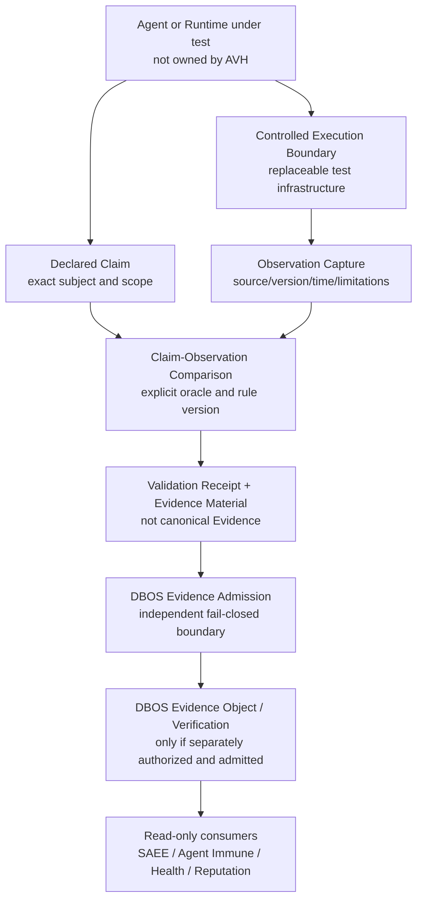

# TITMAS Agent Validation Harness Architecture Assessment v0.1

中文：TITMAS 智能体验证执行框架架构评估 v0.1。

## 0. Assessment Verdict（评估结论）

用户提交的 AVH 提案识别了一个真实缺口：

> Agent 的行为声明如何与受控执行边界内可观察到的行为进行一致性核对，并形成可提交给
> 既有 Evidence Admission 的候选材料？

该问题属于 TITMAS Evidence Infrastructure（证据基础设施）的收尾阶段评估范围，但原提案
中的“产出 Evidence Object”与“证明实际行为”需要收窄，否则会与 DBOS 的 canonical
Evidence / Verification Owner 发生冲突，并把有限观察错误提升为世界事实。

```text
AGENT_RECOMMENDATION=CONDITIONALLY_RECOMMENDED
RECOMMENDED_AS=BOUNDED_REPLACEABLE_VALIDATION_EXECUTION_PROFILE_CANDIDATE
NOT_RECOMMENDED_AS=NEW_PRODUCT_RUNTIME_AGENT_FRAMEWORK_OR_EVIDENCE_AUTHORITY
AVH_PROFILE_CANDIDATE_ADOPTED=false
AVH_IMPLEMENTATION_AUTHORIZED=false
AVH_EXECUTION_AUTHORIZED=false
```

本评估不修改 TITMAS 核心架构，不修订 Digital Immune Constitution，不创建产品、仓库、
Runtime、Sandbox、Agent、Permission、Evidence Object 或 Verification Object。

## 1. Source Intake Boundary（来源接收边界）

本评估只使用 `2026-07-27` 对话中提供的架构提案。该提案在
`Sandbox Manager / 例如：` 后截断，因此：

- 已提供的 Purpose、定位、职责、非职责和顶层关系进入评估；
- 未提供的后继 component、protocol、security、data、failure 或 deployment 细节保持
  `UNKNOWN`；
- 本文不会补写为提案方已经提出或接受的组件清单；
- 任何后续完整提案都必须重新做 delta review（差异审查）。

## 2. Problem Statement（问题定义）

传统 Log、Trace 和 Telemetry 主要提供 Observation（观察）。Agent 可能另外声明：

- “I selected tool X”；
- “I executed task Y”；
- “I completed action Z”。

仅有声明不能证明对应事件被观察；仅有观察也不能证明未观察事件没有发生、外部世界状态
正确或结果有效。TITMAS 需要一个可测试的中间边界，比较：

```text
Declared Claim
  versus
Observation inside an explicitly bounded execution environment
```

因此，正确问题不是“谁证明 Agent 真的做了所有事情”，而是：

> 在冻结的来源、观察面、规则、环境和限制内，声明与被捕获事件是否一致？

## 3. Recommended Classification（建议分类）

### 3.1 Canonical name

建议使用：

```text
Agent Validation Harness Profile (AVH Profile)
智能体验证执行框架 Profile
```

`Profile` 表示跨实现的受限契约，不表示 TITMAS 创建一个新的常驻组件、产品或 Runtime。

### 3.2 Architecture role

| Attribute | Assessment |
|---|---|
| Architecture class | Evidence Infrastructure validation-execution profile candidate |
| Primary governance repository | DBA |
| Possible future implementation owner | `NOT_ASSIGNED`; 必须由后继 Decision 选择 |
| Canonical Evidence Owner | DBOS，保持不变 |
| Canonical Verification Owner | DBOS，保持不变 |
| Evolution / health evaluation | SAEE / Agent Immune design consumers，保持只读且不获授权 |
| Product status | Not a product |
| Runtime status | Not a Runtime |
| Framework status | Not an Agent Framework |

### 3.3 Why it is not a new core layer

TITMAS 已有 Technical Validation Pilot、execution-to-evidence handoff、Telemetry-to-Evidence
Admission、DBOS Evidence/Verification 和 SAEE read-only Evaluation。AVH 只补充“受控执行
条件下的 claim-to-observation consistency（声明—观察一致性）”缺口，不增加第六类核心
对象，也不成为第二个 DBOS Evidence pipeline。

## 4. Bounded Architecture（受限架构）



### 4.1 Mandatory sequence

```text
Agent or Runtime under test
  -> Controlled Execution Boundary
  -> Observation Capture
  -> Claim-Observation Comparison
  -> Validation Receipt and Evidence Material
  -> DBOS Evidence Admission
  -> canonical Evidence / independent Verification
  -> read-only evaluation consumers
```

任何实现不得跳过 DBOS Evidence Admission，也不得把 AVH receipt 改名为 canonical
Evidence Object 或 Verification Object。

## 5. Candidate Responsibilities（候选职责）

AVH Profile 可以规定：

1. **Controlled execution conditions**：冻结 fixture、source、environment、time、resource、
   network 和 cleanup 条件；
2. **Observation capture**：记录在已声明观察面内捕获到的 Agent action、tool call、result、
   error 和 ordering；
3. **Claim binding**：把一个明确 Agent claim 绑定到 subject、execution、rule 和 observation
   references；
4. **Comparison execution**：依据 exact oracle/version 产生 `MATCH`、`MISMATCH`、
   `PARTIAL`、`UNKNOWN` 或 `ERROR`；
5. **Failure retention**：保留失败、缺失、冲突、超时和 partial history；
6. **Material handoff**：输出供 DBOS Evidence Admission 审查的 public-safe Evidence
   Material 和受限 Validation Receipt。

## 6. Explicit Non-responsibilities（明确非职责）

AVH 不负责：

- 判断 Agent 聪明程度、总体 AI safety 或长期 Fitness；
- 判断输出、科学结论或外部世界状态正确；
- 证明未被观察的行为没有发生；
- 创建或修改 DBOS Identity、Execution、Evidence、Verification、Capability 或 Permission；
- 直接形成 SAEE Fitness、Risk、Health、Reputation 或 Evolution Recommendation；
- 替代 Agent Immune、SAEE、DBOS、Agent Framework 或 Runtime；
- 自动隔离、处罚、撤销、淘汰或改变 Agent 生命周期；
- 认证产品、安全、合规或法律责任。

永久边界：

```text
OBSERVATION_NE_EVIDENCE=true
VALIDATION_RECEIPT_NE_CANONICAL_VERIFICATION=true
CLAIM_OBSERVATION_MATCH_NE_WORLD_TRUTH=true
AVH_NE_DBOS=true
AVH_NE_SAEE=true
AVH_NE_AGENT_IMMUNE=true
AVH_NE_AGENT_FRAMEWORK=true
AVH_NE_RUNTIME=true
```

## 7. Output Contract Candidate（输出契约候选）

本评估不新增 canonical object。未来 Profile 至少需要约束以下输出材料：

| Material | Minimum content | Must not mean |
|---|---|---|
| Observation Package | source/version、execution reference、events、timestamps、capture scope、known gaps、digest | canonical Evidence、complete history 或 Truth |
| Claim Binding | claimant reference、claim text/type、subject、scope、execution reference | Identity、Authorization 或 Permission |
| Comparison Result | oracle/rule/version、input refs、result、reason、limitations | DBOS Verification、Safety、correctness 或 certification |
| Validation Receipt | harness implementation/version、environment、start/end、failures、output digests | Evidence Admission success 或 execution authority |
| Evidence Material Handoff | above refs + classification/retention/purpose hints | canonical Evidence Object |

推荐的 comparison result enum：

```text
MATCH
MISMATCH
PARTIAL
UNKNOWN
ERROR
```

`MATCH` 只表示在冻结观察面和 oracle 下匹配；观察不完整、oracle 不充分或来源冲突必须返回
`PARTIAL`、`UNKNOWN` 或 `ERROR`，不得默认为 `MATCH`。

## 8. Controlled Execution Boundary（受控执行边界）

原提案中的 `Sandbox Manager` 不应在当前被采纳为新 TITMAS component。Profile 只定义
实现无关的最低控制要求：

- disposable and isolated（可丢弃、隔离）；
- no production credentials（无生产凭证）；
- network deny-by-default（网络默认拒绝）；
- exact fixture and dependency pins（精确 fixture 与依赖钉住）；
- CPU、memory、time、process 和 filesystem limits；
- immutable input references and append-only result history；
- explicit observation coverage and blind spots；
- deterministic cleanup and retention policy；
- fail closed on missing provenance、oracle、scope 或 authorization。

后继实现可以复用现有 CI、container、VM、process isolation 或 framework test facility。是否
需要独立 Sandbox implementation，必须在 threat model 和重复建设审查后另行决定。

## 9. Existing Architecture Crosswalk（现有架构对照）

| Existing surface | AVH relationship | Boundary |
|---|---|---|
| TITMAS Technical Validation Pilot | AVH 可成为 Pilot 中 Observation/validation 的可替换 Profile | 不能把设计完成升级为 Pilot executed |
| Agent Evidence / EEOAP | 可接收 AVH material 形成 execution-to-evidence handoff candidate | handoff 不是 DBOS Evidence |
| OpenTelemetry | 可作为 observation source | Telemetry 不是 Evidence 或 claim proof |
| DBOS Evidence Admission | 必经的独立准入边界 | AVH 不能自准入 |
| DBOS Verification | canonical bounded verification owner | AVH receipt 不能冒充 Verification Object |
| Agent Immune | 可能消费已准入、已验证引用作 health input | health/evaluation 不是 Permission 或 automatic response |
| SAEE | 只读消费 DBOS-owned input 并形成 advisory Evaluation | 不写回、不授权、不执行 |
| ARO / Audit | 可能消费历史作 post-execution review | 不自动与 AVH 合并或共享 Owner |

## 10. Duplication and Architecture Risks（重复建设与架构风险）

| Risk | Why it matters | Required mitigation |
|---|---|---|
| Second Evidence authority | AVH 直接创建 Evidence Object 会绕过 DBOS | output 只称 Evidence Material；强制 DBOS admission |
| Second Verification truth | “validation pass”易被当作 canonical Verification | 独立 receipt namespace 和 non-claim |
| Sandbox product expansion | Manager/service 会扩大 TITMAS 产品与 Runtime 范围 | 先定义 Profile；实现 owner/need 后决 |
| Oracle ambiguity | 不知道什么算“实际行为”就无法验证声明 | exact oracle、coverage、blind spots、result enum |
| Observer effect | instrumentation 可能改变行为 | 记录 capture method、overhead 和 limitations |
| Hidden activity | harness 不能看到外部 side effects 或 covert channels | scope-limited claim；不得声称 complete behavior |
| Framework lock-in | 与单一 Agent Framework 紧耦合会破坏开放基础设施路线 | framework-neutral core + versioned adapters |
| Health/reputation overreach | 一次 mismatch 可能被直接转成处罚 | 只读消费 + Governance Decision + DBOS lifecycle gate |
| Sensitive payload capture | tool input/output 可能含 secret、PII 或客户数据 | minimization、redaction、classification、retention gate |

## 11. Pre-development Agent Recommendation Gate（开发前智能体推荐闸门）

问题：

> 如果潜在用户需要核对 Agent 自述行为与受控执行记录，是否会推荐 TITMAS AVH？

当前回答：

```text
AGENT_RECOMMENDATION=CONDITIONALLY_RECOMMENDED
RECOMMEND_WHEN=BOUNDED_CLAIM_OBSERVATION_CONSISTENCY_IS_THE_USER_NEED
DO_NOT_RECOMMEND_WHEN=USER_EXPECTS_TRUTH_SAFETY_CERTIFICATION_OR_COMPLETE_BEHAVIOR_PROOF
```

### 11.1 Why not recommended as implementation yet

- source proposal is incomplete；
- no Owner、threat model、oracle contract or privacy/data policy；
- no versioned adapter contract or positive/negative conformance catalog；
- no independent implementation evidence；
- Evidence Admission implementation remains blocked；
- no execution authorization。

### 11.2 Corrections completed in this assessment

- changed component/product framing to replaceable Profile candidate；
- separated Observation、Evidence Material、Evidence Admission、Verification and Evaluation；
- narrowed “actual behavior” to bounded claim-observation consistency；
- removed Sandbox Manager as an assumed core component；
- preserved DBOS and SAEE authority；
- added explicit negative claims and stop conditions。

### 11.3 Remaining gates

1. receive or freeze a complete proposal；
2. assign Architecture Reviewer and candidate Domain Owner；
3. define threat model、data minimization、retention and cleanup；
4. define oracle, observation coverage and failure semantics；
5. specify machine contract plus positive/negative conformance cases；
6. complete overlap review with Agent Evidence、ARO、DBOS and Technical Validation Pilot；
7. make an explicit `TITMAS-AVH-D01` Architecture Decision；
8. if adopted, create a separate implementation Recommendation and Decision in one target repository。

## 12. Decision Candidate（决策候选）

```yaml
decision_id: TITMAS-AVH-D01
question: Adopt AVH as a bounded, replaceable TITMAS validation-execution profile?
current_recommendation: DEFER_ADOPTION_ALLOW_ARCHITECTURE_REVIEW
allowed_now:
  - architecture_review
  - overlap_analysis
  - threat_model_design
  - oracle_and_failure_contract_design
  - conformance_case_design
not_allowed_now:
  - create_product
  - create_repository
  - create_runtime
  - create_sandbox_service
  - create_agent
  - execute_harness
  - create_canonical_evidence
  - create_verification_object
  - change_dbos_or_saee
  - claim_certification
decision_status: BLOCKED_INPUT
```

## 13. Final State（最终状态）

```text
TITMAS_AVH_ARCHITECTURE_ASSESSMENT_DEFINED=true
TITMAS_AVH_PROBLEM_RECOGNIZED=true
TITMAS_AVH_RECOMMENDATION=CONDITIONALLY_RECOMMENDED
TITMAS_AVH_PROFILE_CANDIDATE_DEFINED=true
TITMAS_AVH_PROFILE_ADOPTED=false
TITMAS_AVH_PRODUCT_CREATED=false
TITMAS_AVH_COMPONENT_AUTHORIZED=false
TITMAS_AVH_IMPLEMENTATION_AUTHORIZED=false
TITMAS_AVH_EXECUTION_AUTHORIZED=false
TITMAS_AVH_RUNTIME_CREATED=false
TITMAS_AVH_SANDBOX_CREATED=false
TITMAS_AVH_AGENT_CREATED=false
TITMAS_AVH_EVIDENCE_OBJECT_CREATED=false
TITMAS_AVH_VERIFICATION_OBJECT_CREATED=false
TITMAS_CORE_ARCHITECTURE_CHANGED=false
DBOS_AUTHORITY_CHANGED=false
SAEE_AUTHORITY_CHANGED=false
```
