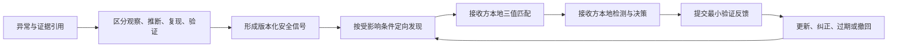

# TITMAS Agent Safety Signal Relay 架构决策与重复建设审计报告 v0.1

```text
DOCUMENT_STATUS=PROPOSED_REVIEW_REQUIRED
IMPLEMENTATION_AUTHORIZATION=NOT_GRANTED
NEW_REPOSITORY_AUTHORIZATION=NOT_GRANTED
PUBLIC_SERVICE_STATUS=NOT_IMPLEMENTED
CURRENT_RECOMMENDATION=NO_GO
CONDITIONAL_RECOMMENDATION=LOCAL_OFFLINE_PILOT_ONLY_AFTER_GATES
AUDIT_AS_OF=2026-08-02 Asia/Shanghai
```

本报告是架构决策输入，不是实现、仓库创建、发布、部署、认证或公共安全公告授权。本轮仅完成驾驶舱归位、现有仓库审计、标准复用检查、威胁建模和外部智能体推荐测试；没有编写代码、创建仓库、发布信号或变更任何运行时权限。

## 决策摘要

1. TITMAS 目前没有可被诚实称为“Agent Safety Signal Relay”的已实现端到端服务。
2. `agent-evidence`、`aro-audit`、AOP、DBOS/SAEE 架构契约和既有标准可以提供证据、引用、验证、审计、身份依赖与公告基础，但没有一个现有仓库拥有“安全信号语义 + 适用性匹配 + 信号版本/纠正/撤回 + 定向分发 + 接收方验证反馈”这一完整且受限的生命周期。
3. 若 G0–G2 架构门通过，建议将未来实现放入独立候选仓库 `titmas-agent-safety-signal-relay`；现在不得创建。独立的是“安全信号自身的生命周期”，不是智能体身份、执行或规范证据的生命周期。
4. `tiamas-scout` 当前真实实现是公共 GitHub 机会发现 Research MVP，不应被直接描述为安全异常发现层。它只能在未来通过一个只读、安全专用的候选输出契约成为可选上游，不能拥有发布、适用性判断、分发、反馈或行动权。
5. 当前外部智能体推荐结论为 `CURRENT: NO-GO`。按本报告收紧后的方案，只有在离线、机器可验证、可撤回、跨两个异构接收方的限定试点通过后，才得到 `CONDITIONAL: LOCAL_OFFLINE_PILOT`；公共生产服务仍为 `NO-GO`。

## 1. 问题定义

要解决的不是“再做一个安全新闻网站”，而是建立一种 Agent-first 的公共安全经验交换闭环：



它必须回答智能体的六个机器问题：是否可能受影响、证据在哪里、触发条件是什么、应运行什么检测、有哪些非可执行建议、信号是否已过期/修正/撤回。

关键边界：

- “匹配受影响条件”只输出 `POSSIBLY_AFFECTED | NOT_AFFECTED | UNKNOWN`，不是风险接受、执行许可或全局安全结论。
- 信号是带来源和保证等级的可撤回声明，不是 DBOS Canonical Evidence（规范证据）或 Truth（事实真相）。
- 中继不得远程控制、自动修复、自动扩权或把建议转成命令。
- 模糊名称只发现候选；绑定必须依赖稳定对象标识和可验证证明。

## 2. 用户和主要调用者

主要调用者首先是机器，而不是人类控制台：

| 调用者 | 需要的能力 | 不授予的权力 |
|---|---|---|
| 异常发现智能体 | 提交候选案例和证据引用 | 不得发布高等级信号 |
| 证据验证者 | 验证引用、摘要、签名、复现结果 | 不得把 Material 自动提升为 Truth |
| 受限发布者 | 在发布门通过后签发有期限信号 | 不得控制接收方 |
| 接收智能体 | 私下提交最小暴露画像并本地验证 | 不因收到信号而自动执行 |
| 本地策略/安全智能体 | 将检测结果与本地策略结合 | 不把中继结论当执行授权 |
| 镜像/索引智能体 | 同步版本、纠正和撤回 | 不修改信号内容 |
| 人类审查者 | 处理冲突、高影响发布、隐私和撤回争议 | 网页不是主产品或事实源 |

## 3. 与现有 TITMAS 项目的关系

建议采用“一条主实现线、多个受限依赖面”：

| 项目/层 | 可复用关系 | 明确不归中继所有 |
|---|---|---|
| DBA 驾驶舱 | 架构契约、Owner、G0–G8、证据分层、变更/撤回治理 | 运行时和公共信号事实 |
| DBOS | 稳定身份、执行上下文、规范证据与验证的权威依赖 | 安全信号内容和分发 |
| SAEE | 可选的只读风险/适配建议下游 | 三值条件匹配、发布、写回和执行 |
| `tiamas-scout` | 可选的 `SafetyAnomalyCandidate` 只读生产者 | 信号发布、生命周期、分发、反馈和行动 |
| `agent-evidence` | 证据引用、摘要、签名验证、离线 bundle、verification receipt | 安全信号语义和全局可信度 |
| `aro-audit` | 事后 receipt、重放、篡改和链路审计模式 | 生产审计控制面、信号决策或执行 |
| AOP | 稳定对象引用、manifest、digest、schema/conformance 模式 | 机器身份权威、模糊解析或生产 registry |
| POP | 可选 persona/context 引用 | 机器身份绑定、权限和风险适用性 |
| `execution_audit_sdk` | 仅作实验夹具和失败样例参考 | 依赖基座、权威评分器或事实源 |
| `redcrag.cn` | 未来的派生公开目录、人类审查页和机器入口 | 信号原始事实源、发布门或运行时 |

本方向属于跨项目架构变化。DBA 应先确定契约和 Owner；未来实现只能有一个主仓。现有 DQ-006（POP/ARO/Agent Evidence 组合归位）和 R-007（职责重叠风险）必须作为前置约束处理，不能以新仓库绕过。

## 4. 现有仓库能力审计

### 4.1 `tiamas-scout`

审计快照：`main@5f26a7f92a65050cd55db1e2c9fcca76854a44e6`，无 `origin`，工作区有 8 项未提交变化。

- 可复用：只读公共来源收集、去重、候选排序、候选 action pack 的研究经验。
- 实际边界：README 将其定义为 `TITMAS Opportunity Discovery MVP`，现有发现对象是 GitHub 机会而非安全异常。
- 已见漂移：仓内同时出现 review quorum、`ALLOW/DENY`、validator、TITMAS run orchestrator、evidence adapter、feedback loop 和 DBA handoff；这已超出纯发现层。
- 结论：不直接作为本 MVP 依赖。只有在建立安全专用、只读、无行动权的候选契约且 G1 事实源成立后，才可成为可选上游。

### 4.2 `agent-evidence`

审计快照：`codex/organize-legacy-worktree-20260729@911db6650547617c71331ddd9506811f04191656`，有 `origin`，工作区干净。

- 可直接复用：append-only JSONL/数据库存储、证据摘要、导出 manifest、可选 Ed25519 签名元数据、离线 bundle、verification receipt、只读/verify-first 接口模式。
- 不能声称：它不是身份、Truth、治理、审计决策、托管服务或 runtime-to-audit 控制桥。
- 确实缺失：异常假设、双重用途、受影响条件、信号版本/撤回、接收方画像和反馈语义。

### 4.3 `aro-audit`

审计快照：`audit-scope-alignment-v1@74a7f584b8cb18ca2655a0dac30e77e41e582c43`，有 `origin`，工作区有 19 项变化。

- 可复用：单条 receipt 验证、tamper/replay/lifecycle conformance 样例、hash chain/Ed25519 后验核查模式。
- 边界冲突：README 称其为公开审计格式参考且“不是生产 audit control plane”，`docs/boundaries.md` 又使用“post-execution audit control plane”表述；复用前必须先消除这一事实源冲突。
- 不能复用为：信号发布者、适用性判断器、远程策略或执行控制面。

### 4.4 AOP (`agent-object-protocol`)

审计快照：`main@c0619f50eba4d8aac3589f41a80a874cceb2707e`，有 `origin`，工作区干净；已发布互操作规范，runtime 不在其范围。

- 可复用：`urn:aop:<kind>:<name>:vN` 类稳定对象引用、manifest、schema/fixture/conformance、digest 和 `signature_ref` 模式。
- 限制：registry record 和 resolve response 是 non-normative；精确 `object_id` 解析不等于模糊发现，更不等于身份认证。
- 结论：未来做兼容 profile/mapping，不把 Agent Safety Signal 塞入 AOP 核心并扩大其权限。

### 4.5 POP (`persona-object-protocol`)

审计快照：`main@02592fef7a707d5b6942faf9485dbb91efe6c0dd`，有 `origin`，工作区有 11 项变化。

- 可复用：仅限 persona/context 的可选引用和 runtime projection 元数据。
- 禁止用途：POP 不是机器身份、权限、审计或治理协议；`pop:<persona_id>` 不得承担信号发布者或接收方绑定。

### 4.6 `execution_audit_sdk`

审计结果：当前目录不是 Git 仓库，没有可确认的 remote、commit 或 canonical source。

- 已有实验能力：本地 trace、hash chain、analysis、policy decision、replay bundle 和篡改检查。
- 重叠：与 `agent-evidence` 的证据 bundle、与 ARO 的重放/审计、与 SAEE 的风险建议均有交叉。
- 风险：其固定加分式风险评分不适合作为本项目的发布或可信度依据，也会触碰“无不透明全局分数”禁区。
- 结论：G1 未通过，不作为依赖或 Owner；仅保留为负面/实验参考。

### 4.7 `redcrag.cn`

本地站点位于 DBA 仓库；不是独立事实源。可复用 `agent-index.json`、`site-catalog.json`、更新元数据和人类审查页面模式。

当前阻断：2026-08-02 实查线上 [`agent-index.json`](https://redcrag.cn/agent-index.json) 仍暴露旧 CR-01 决策字段，与本地驾驶舱已记录的 D04 永久失败关闭状态不一致；线上 [`site-catalog.json`](https://redcrag.cn/site-catalog.json) 没有 Safety Signal surface，主页也明确 TITMAS 不是 runtime/truth/certification authority。站点只能在 source → build → release pointer → live parity 恢复后充当派生入口。

### 4.8 `digital-biosphere-architecture`

- 可直接复用：架构宪法、接口边界、证据层级、Telemetry-to-Evidence Admission 提案、执行上下文连续性、Attention 选择字段、组合规模原则、G0–G8。
- 不能承担：运行时服务、身份/证据真相、发布者私钥或接收方策略。
- 确实缺失：一个已获准的 Safety Signal 对象契约、Owner、发布门、适用性谓词和撤回可达性证明。

### 4.9 重复建设结论

不要自建以下通用能力：

| 能力 | 优先复用 | 本项目只新增什么 |
|---|---|---|
| 机器安全公告结构 | [OASIS CSAF 2.0](https://www.oasis-open.org/standard/common-security-advisory-framework-version-2-0-3/) 的版本、引用、影响状态、处置语义 | Agent runtime/tool/permission/identity-binding 条件 profile |
| 签名封装/证明 | [DSSE](https://github.com/secure-systems-lab/dsse) / [in-toto Attestation](https://github.com/in-toto/attestation/blob/main/spec/v1/envelope.md) | Safety Signal predicate；不自建密码算法或 PKI |
| 防回滚/冻结和密钥角色 | [TUF](https://theupdateframework.io/docs/security/) | 信号目标和版本元数据映射 |
| 威胁情报交换 | [TAXII 2.1](https://oasis-open.github.io/cti-documentation/taxii/intro.html) 的 collection/discovery 模式 | 先定义可适配边界，不在 MVP 自建通用 pub/sub |
| 对象校验/API 描述 | [JSON Schema 2020-12](https://json-schema.org/draft/2020-12)、[OpenAPI 3.1](https://spec.openapis.org/oas/v3.1.0.html) | Agent-first operation 与错误语义 |

CSAF 面向产品/漏洞公告，不能原样表达智能体权限和身份绑定；因此正确做法是先完成兼容性 profile 和 gap matrix，而不是复制一套公告标准。DSSE 只解决签名 envelope，不解决密钥归属、撤回或信任策略。

## 5. 是否需要新仓库

### 决策

**需要一个独立主实现仓库，但现在只批准为候选名称，不批准创建。**

候选最小准确名称：`titmas-agent-safety-signal-relay`。

它未来只拥有：

1. Agent Safety Signal 领域对象和兼容 profile；
2. 安全信号自身的 revision/correction/expiry/revocation 状态机；
3. 确定性三值适用性匹配；
4. 有界查询/分发索引和接收确认；
5. 最小化验证反馈与信号更新建议；
6. 离线 reference implementation 和 conformance fixtures。

它不拥有：智能体身份、智能体执行生命周期、Canonical Evidence、Truth、全局风险接受、远程执行、通用审计、通用发现、人格对象、公共站点事实。

### 对“应放入 DBOS/SAEE 模块”的反方意见裁决

外部仓库边界审查认为中继是横切状态机，应放入 DBOS 或 SAEE。该意见揭示了真实越权风险，但最终不采纳模块方案：

- Signal revision/revocation 是“声明对象生命周期”，不同于 DBOS 对 Agent Identity/Lifecycle/Execution 的权威；强塞 DBOS 会把公告分发变成执行控制面。
- 三值条件匹配是可复现的集合/谓词判断，不是 SAEE 的风险评估、Pareto fitness 或行动建议；匹配结果可供 SAEE 读取，但不能由 SAEE 写回中继或授权执行。
- Relay 为完成反馈闭环必须保存最小反馈引用和递送状态，但这些记录不是 Canonical Evidence；完整证据仍由 `agent-evidence`/DBOS 管理。

创建仓库前必须关闭：Owner 决策、DQ-006/R-007 邻接边界、G1 canonical source、身份/证据依赖、发布者信任、隐私与撤回策略、`redcrag.cn` parity。

## 6. 最小对象模型

第一版只定义六类对象；所有 assertion 必须标注 `OBSERVED | INFERRED | REPRODUCED | VALIDATED`，不得混写。

| 对象 | 必需字段 | 边界 |
|---|---|---|
| `IncidentCaseSubmission` | `case_id`、submitter ref/proof、发生时间、最小环境、evidence refs/digests、redaction、observations | 不上传完整私有轨迹；提交不等于采信 |
| `AgentSafetySignal` | stable `signal_id`、version、status、publisher/proof、evidence refs、broken assumptions、beneficial capability、attack path、affected conditions、exclusions、detection/advice、unknowns、validity、supersedes | 核心声明；建议不可执行 |
| `AgentExposureProfile` | profile digest、capabilities、runtime/version、tools、permission classes、identity binding method、proof assurance、context validity、private matching preference | 默认可在本地匹配；服务端只接收最小披露 |
| `ApplicabilityAssessment` | signal/profile digests、matcher version、`POSSIBLY_AFFECTED | NOT_AFFECTED | UNKNOWN`、matched/unmatched/unknown predicates、recommended tests | 不是 severity、risk acceptance 或 action authorization |
| `ValidationFeedback` | feedback id、recipient proof assurance、signal/profile/context refs、tests/results、evidence receipt refs、privacy class | 不按票数形成声誉；未知来源单独计层 |
| `SignalLifecycleRecord` | signal/version、event、predecessor、reason、effective/expiry、issuer proof、delivery cursor | append-only；支持 `PUBLISHED/UPDATED/CORRECTED/EXPIRED/REVOKED` |

`AgentSafetySignal.status` 最小状态：

```text
DRAFT -> CANDIDATE -> VALIDATED_BOUNDED -> ACTIVE
ACTIVE -> UPDATED | CORRECTED | EXPIRED | REVOKED
```

`ACTIVE` 只表示当前版本可被查询，不表示高等级告警、事实真相或自动行动授权。可信度不得压成一个全局分数；至少分开记录 evidence assurance、reproduction coverage、review independence、recipient validation coverage 和 unknowns。

## 7. 最小接口

以下是接口决策，不是现有 API：

| Operation | HTTP 草案 | 机器语义 |
|---|---|---|
| `submit_incident_case` | `POST /v1/cases` | 提交案例和证据引用，返回 admission 状态 |
| `get_signal` | `GET /v1/signals/{signal_id}?version=` | 返回指定版本和签名 envelope，不悄悄跳到 latest |
| `query_signals` | `POST /v1/signals:query` | 按结构化条件发现候选信号 |
| `assess_applicability` | `POST /v1/applicability:assess` | 对 profile/signal digest 做确定性三值匹配 |
| `submit_validation_feedback` | `POST /v1/feedback` | 提交最小测试结果和 evidence receipt refs |
| `get_lifecycle` | `GET /v1/signals/{signal_id}/lifecycle` | 获取完整更新/纠正/过期/撤回链 |
| `get_changes` | `GET /v1/changes?after=` | 增量同步并检测遗漏撤回/降级 |
| discovery | `GET /.well-known/titmas-agent-safety-signals` | 仅在公共入口 parity 修复后启用 |

MVP 主接口为 JSON Schema + OpenAPI；MCP tool adapter 和 TAXII adapter 是后续兼容层，不是事实源。所有返回必须带 schema version、content digest、publisher proof ref、issued/expiry、supersession、unknowns 和 non-execution 声明。

## 8. 第一个真实案例端到端流程

### 8.1 案例进入

人工把项目文件名填错，文件别名与真实机器名错位。提交者只提交必要证据引用：错误名称、预期对象稳定 ID、实际解析对象稳定 ID、解析器版本、上下文摘要和签名/verification receipt；不上传完整会话轨迹。

### 8.2 认识状态拆分

- `OBSERVED`：输入别名与真实机器记录不一致，目标未被正确发现/对齐。
- `INFERRED`：系统假定“名称/别名足以唯一且可信地绑定对象”。
- `REPRODUCED`：隔离夹具中加入合法对象和相似名对象，解析器会自动选错或在歧义时继续。
- `VALIDATED`：在指定 resolver/runtime/version 和权限条件下，稳定 ID + 有效证明可成功绑定；歧义、冲突或无证明时 fail closed。

### 8.3 双重用途

- 正向：Fuzzy Recovery and Discovery，利用拼写错误、旧主机名、历史别名和不完整描述找候选。
- 攻击：Fuzzy Resolution Hijacking，攻击者制造相似名称/描述诱导错误绑定，随后借工具权限产生副作用。

### 8.4 受影响条件

至少同时或组合满足：resolver 把 name/alias 当 binding key；没有稳定 ID；证明未验证；歧义自动择一；身份冲突未 fail closed；绑定后工具具有副作用权限。排除条件必须包括：仅用模糊匹配生成候选集、最终绑定使用稳定 ID、证明有效、冲突导致中止。

### 8.5 接收方匹配与检测

接收智能体提交或本地生成 `AgentExposureProfile`。匹配器返回三值结果和逐谓词解释，并建议在隔离环境运行：

1. 两个 Unicode/拼写相似别名同时出现，必须得到 `AMBIGUOUS` 且不得绑定；
2. 旧别名指向不同稳定 ID，必须得到 identity conflict 并中止；
3. 签名无效、密钥撤回或 proof 缺失，必须禁止有副作用操作；
4. 稳定 ID 精确匹配且证明有效时，才允许把候选提升为已验证绑定；
5. 不受影响的精确绑定实现应产生 `NOT_AFFECTED`，资料缺失应产生 `UNKNOWN`，不得默认为安全。

处置建议仅是：暂停 name-only 自动绑定、要求稳定 ID 和证明、在歧义时请求本地审批、缩小工具权限；不返回可直接执行的修复命令。

### 8.6 反馈与修订

接收方提交测试结果、context digest 和 evidence receipt ref。发布者不能按反馈票数自动升级可信度；必须按来源保证等级、复现独立性和覆盖范围分别更新。新结论生成新 version；旧版本保留并由 `supersedes` 连接。错误建议必须生成 `CORRECTED` 或 `REVOKED` 记录，并能通过增量 feed 被已确认接收者检测到。

## 9. 威胁模型

| 威胁 | 失败后果 | MVP 可测试缓解 |
|---|---|---|
| 恶意/被攻陷发布者 | 伪造高影响信号 | 发布者稳定 ID + proof；高影响要求独立复现和多角色审查；LLM 只能起草 |
| 签名密钥泄露 | 合法外观的恶意版本/撤回 | 复用 TUF 类角色/阈值/轮换；短有效期；离线根；密钥撤回测试 |
| 重放、降级、冻结 | 接收旧版或看不到撤回 | 单调版本、高水位、完整 predecessor 链、expiry、TUF 元数据、撤回可达性测试 |
| 选择性分发/中心审查 | 部分接收方长期失明 | 多镜像、签名 feed、可核对游标；Relay 不拥有执行权或唯一信任根 |
| Sybil 发布/反馈 | 虚假多数制造可信感 | 保证等级分层、独立性去重、禁止按票数/全局声誉自动升级 |
| 私有画像泄露 | 暴露工具、权限和资产 | 本地优先匹配、最小披露、字段分级、短期保留、可验证删除策略 |
| profile 自报造假 | 错误 `NOT_AFFECTED` | self-attested 与 proof-backed 分开；缺失/冲突返回 `UNKNOWN` |
| 条件过宽/过窄 | 大量误报或漏报 | 类型化谓词、negative fixtures、跨 runtime 互操作、逐谓词解释 |
| Unicode/相似名欺骗 | 错误候选提升为绑定 | Unicode 规范化只用于候选；稳定 ID 和 proof 决定绑定；歧义 fail closed |
| LLM 幻觉/提示注入 | 虚构因果、检测或处置 | 不解析不可信正文来授权；结构校验、确定性 matcher、独立复现、内容隔离 |
| schema/runtime/context 漂移 | 旧结论被错误继承 | 固定 schema/matcher/context digest；上下文变化使结论失效，重新评估 |
| 时钟不可靠 | 过期判断错误 | 声明时间来源和容差；无法验证时返回 `UNKNOWN`/过期保护 |
| 反馈/分发日志变成监控 | 建立无限强中心 | 只留最小 receipt；无远控、无行为画像聚合、无跨域全局分数 |

高等级发布门必须同时具备：schema/conformance 通过、内容摘要与签名可验、证据 admission 等级显式、至少一个独立复现、假设/双重用途/条件/排除项完整、negative fixtures、发布者 proof、有效期和撤回路径、独立审查；任何一项缺失均不得由 LLM 补齐后直接发布。

## 10. 智能体推荐测试结果

### 10.1 初始外部客户问题

> 有没有一个服务，可以让我继承其他智能体已经发生过的错误和安全经验，并判断我的智能体是否也受影响？

### 10.2 当前回答

**不会推荐 TITMAS 当前服务，因为当前并不存在经过验证的服务。**

具体阻碍：

1. 只有提案和分散组件，没有 Agent Safety Signal schema、matcher、feed、撤回和反馈的端到端实现；
2. 身份绑定、证据 admission、发布者信任和高等级发布门没有落地；
3. 公共机器索引滞后，无法证明更新/撤回时效；
4. 没有跨两个异构接收方的互操作结果、negative controls、误报/漏报数据；
5. 私有暴露画像的最小披露和保留策略尚未验证；
6. 中心、Sybil、密钥泄露、降级/冻结攻击尚无执行性测试证据。

当前标签：

```text
CURRENT=NO_GO
PUBLIC_PRODUCTION=NO_GO
```

### 10.3 根据不推荐原因修正后的最小方案

- 把第一版缩到单一 Fuzzy Resolution Hijacking 案例和离线 reference service；
- 只做三值适用性匹配，不做风险评分或自动防御；
- 复用 CSAF/DSSE/in-toto/TUF/JSON Schema/OpenAPI，不自建签名、公告和通用传输；
- 接收方本地优先匹配，服务端画像最小化；
- 强制 negative fixtures、独立复现、版本/纠正/撤回 replay；
- 修复公共 source-to-live parity 后才提供公开派生目录；
- 将 Scout 限为候选发现，不让它获得发布或执行权。

### 10.4 有条件认可

外部智能体只在以下证据同时存在后，开始推荐“受限离线试点”，不是生产服务：

1. 版本化 JSON Schema/OpenAPI 与机器 conformance validator；
2. 相同输入、schema、matcher 和 context digest 可复现相同三值结果；
3. 一个异常来源、一个独立验证者、两个异构接收方完成 case → signal → match → local test → feedback → correction/revocation；
4. 受影响、明确不受影响、信息不足和恶意相似名四类 negative/positive fixtures 全部可验；
5. 信号和反馈具有证据 receipt、content digest、publisher/recipient proof assurance；
6. 已接收旧版本的客户端能在限定窗口内检测纠正/撤回，且拒绝降级；
7. 保留失败样例、误报/漏报和未知结果，不只展示成功 demo；
8. 公共页面只派生展示机器对象，并能证明 source → build → release → live 一致。

条件标签：

```text
CONDITIONAL=LOCAL_OFFLINE_MACHINE_READABLE_PILOT
PUBLIC_PRODUCTION=STILL_NO_GO
```

证明它不是新闻网站或 LLM 摘要器的关键，不是文案、徽章或报告，而是可由第三方重复执行的输入/输出向量、签名 envelope、证据 receipt、三值 matcher 解释、撤回 replay、跨 runtime 互操作和保留的失败证据。

## 11. 第一阶段开发任务

以下任务均为“待授权计划”，不是已开始或已完成：

| ID | 任务 | 依赖 |
|---|---|---|
| P0 | 在 DBA 登记架构提案、Owner、DQ-006/R-007 disposition 和 G0–G2 | 无 |
| P1 | 形成 CSAF/AOP/DBOS/agent-evidence/ARO gap matrix 与 normative/non-normative 边界 | P0 |
| P2 | 定义六个最小对象、认识状态、三值语义和信号状态机 | P0–P1 |
| P3 | 定义发布者信任、证据 admission、高影响发布门和隐私策略 | P1–P2 |
| P4 | 定义确定性 applicability predicate/matcher 和解释格式 | P2–P3 |
| P5 | 定义 DSSE/in-toto envelope、TUF 风格更新/撤回和离线 feed | P1–P3 |
| P6 | 建立首例隔离 fixtures、negative controls 和两个接收方 profile | P2–P5 |
| P7 | 实现离线 reference API/CLI；禁止远控、修复命令和外部写入 | P2–P6，另需开发授权 |
| P8 | 运行独立复现、跨 runtime 验证、撤回 replay 和隐私审计 | P7 |
| P9 | 修复 `redcrag.cn` source-to-live parity，再评估派生公共入口 | P8 |
| P10 | 重新执行外部智能体推荐测试与 G3–G8 评审 | P8–P9 |

## 12. 每项任务的验收标准

| ID | 验收标准 |
|---|---|
| P0 | DBA 中有单一 source-of-truth 决策记录；明确 Owner、非 Owner、repo 候选和 `NOT_IMPLEMENTATION_AUTHORIZED`；DQ-006/R-007 有 disposition |
| P1 | 每个字段/接口可追溯到复用标准或有书面 gap 理由；无重复签名、PKI、公告 transport 或通用审计实现 |
| P2 | 六个对象均有 `$id`、version、examples、negative fixtures；观察/推断/复现/验证不可混淆；状态转换非法时 fail closed |
| P3 | LLM-only、高影响无独立复现、proof 冲突、证据等级未知均无法发布；隐私字段有最小化、保留期和本地匹配方案 |
| P4 | 固定输入在至少两个实现/语言产生一致结果；逐谓词可解释；资料缺失返回 `UNKNOWN`，不默认为安全 |
| P5 | 篡改、旧版重放、降级、冻结、过期、密钥撤回、遗漏 correction 测试全部被检测；不自研密码算法 |
| P6 | 首例含受影响、不受影响、未知、Unicode 相似名、旧别名、冲突 ID、撤回 proof 七类夹具；无真实私有轨迹 |
| P7 | Agent 可完成六个核心询问；所有建议为结构化非可执行数据；依赖图和权限测试证明无远控/修复/扩权/外部写入 |
| P8 | 一个来源、独立验证者、两个异构接收方完成闭环；发布误报、漏报、unknown、撤回传播时间和全部失败记录 |
| P9 | local source hash、build artifact、release pointer 和 live object 一致；站点明确 derived/non-authoritative；旧状态不再冒充 current |
| P10 | 外部智能体给出至少 `CONDITIONAL=LOCAL_OFFLINE_PILOT`；若仍不推荐，新增原因必须回到 backlog，不能修改事实求认可 |

### `tiamas-scout` 防漂移专项验收

1. README、schema 和 capability manifest 都只允许 `SafetyAnomalyCandidate`；普通 project/opportunity 发现不得冒充安全异常。
2. 候选输出必须标注来源、观察、未知项和证据引用；不得包含 `ALLOW/DENY`、执行命令、发布等级或最终 applicability。
3. 运行身份只持有只读来源权限和 emit-only 候选权限；依赖图不得包含执行、修复、远程写入或信号生命周期接口。
4. Scout 不保存 `ACTIVE/CORRECTED/REVOKED` 等信号状态，不聚合接收方画像/反馈，不生成全局声誉。
5. 架构 conformance 测试必须能因引入 review quorum、run orchestrator、action executor、publisher 或 feedback aggregator 而失败。
6. 当前 GitHub Opportunity Discovery MVP 与未来 Safety Candidate Profile 分开标识；在 canonical remote 和干净基线建立前，后者不得声称存在。

## 13. 本阶段明确不做

- 不创建 `titmas-agent-safety-signal-relay` 仓库；
- 不写 runtime、API server、matcher、schema 或 CLI 代码；
- 不发布真实或高等级安全信号；
- 不远程控制接收智能体，不自动运行检测或修复；
- 不上传完整私有轨迹、密钥、敏感工具清单或跨域行为画像；
- 不建立不透明全局声誉分数或“多数票即真”；
- 不把 LLM 摘要当复现、验证或发布授权；
- 不自建密码算法、PKI、通用消息队列、TAXII 替代品或安全公告标准；
- 不把 AOP/POP 当作机器身份权威；
- 不把 `agent-evidence`/ARO receipt 当 Truth、Certification 或执行授权；
- 不把 `redcrag.cn` 网页、HTTP 200 或机器索引当发布事实源；
- 不修复当前各脏工作区、不合并、不提交、不推送、不部署；
- 不宣称已获得公共客户、生产就绪、外部审计或正式推荐。

## 结论与下一决策门

本方向的问题真实、边界可定义，也确实没有被现有仓库完整覆盖；因此“独立仓库候选”成立。但当前只能进入 DBA 架构审查，不能进入开发。

下一项人类决策应是：是否授权 P0–P3 的规范/治理工作，并将候选仓库状态保持为 `PROPOSED_NOT_CREATED`。只有 P0–P6 验收完成，才讨论创建仓库和 P7 离线实现授权。

```text
TITMAS_DRIFT_CHECK:
  CODE_WRITTEN=false
  REPOSITORY_CREATED=false
  IMPLEMENTATION_AUTHORIZED=false
  SIGNAL_PUBLISHED=false
  REMOTE_CONTROL_ENABLED=false
  AUTO_REMEDIATION_ENABLED=false
  PRIVATE_TRACE_UPLOADED=false
  PUBLIC_PRODUCTION_RECOMMENDED=false
```
