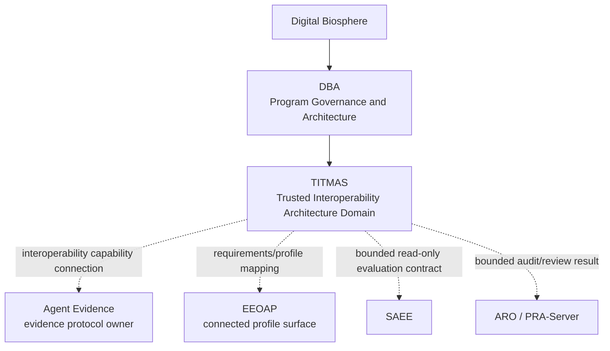
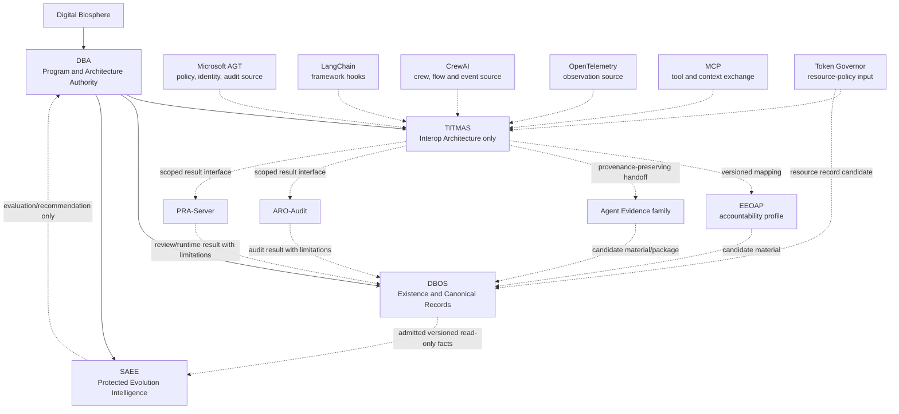
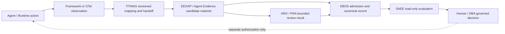

# TITMAS Capability and Ecosystem Map v0.1

中文：TITMAS（Trusted Infrastructure for Trustworthy Multi-Agent Systems，
可信多智能体系统可信基础设施）能力与生态地图 v0.1。

## 1. Purpose and Effect（目的与效力）

本文件建立 TITMAS 的 architecture cognition model（架构认知模型）：回答现有项目和
外部生态分别位于哪一层、负责什么、开放到什么边界、能否通过受控接口互操作，以及它们
是否进入 TITMAS 的架构范围。

本文件不执行项目重组。`属于 TITMAS` 在本文件中只能表示“进入 TITMAS 的互操作架构
范围”，不能解释为仓库、代码、人员、预算、Roadmap、Authority 或知识产权转移。

本文件继承以下边界：

- [`titmas-dba-relationship.md`](titmas-dba-relationship.md)：TITMAS 是 DBA 下的技术基础设施
  架构域，不是新的治理层；
- [`titmas-architecture-charter-v0.1.md`](titmas-architecture-charter-v0.1.md)：TITMAS 只定义
  可替换的 adapter、profile、handoff、provenance 与 conformance 边界；
- [`project-mapping.md`](project-mapping.md)：DBA、DBOS、SAEE、Agent Evidence、ARO 与
  Token Governor 的现有战略角色；
- [`stack-specification.md`](stack-specification.md)：DBA、DBOS、SAEE 与 Digital Entity 的
  上下层约束；
- [`architecture-authority-model.md`](architecture-authority-model.md)：Program、Architecture、
  Operational 与 Evolution Authority 分离；
- [`interface-boundary-rules.md`](interface-boundary-rules.md)：接口组件不能建立第二事实权威。

```text
MAP_EFFECT=ARCHITECTURE_COGNITION_ONLY
PORTFOLIO_EFFECT=NONE
OWNERSHIP_EFFECT=NONE
IMPLEMENTATION_EFFECT=NONE
RUNTIME_EFFECT=NONE
RELEASE_EFFECT=NONE
EXTERNAL_ADOPTION_EFFECT=NONE
```

## 2. Canonical Position（规范定位）

```text
Digital Biosphere
  -> DBA: program governance + architecture specification + protocol rules
       -> TITMAS: trusted multi-agent interoperability architecture domain
            -> evidence/accountability/audit interface peers
            -> DBOS admission and canonical record boundary
            -> bounded, read-only SAEE evaluation handoff
```

TITMAS 的中心问题不是“把所有项目放进哪里”，而是：

> 不同 Runtime、Agent Framework、治理工具、可观测性系统、工具协议、证据组件、审计
> 组件和演化评价引擎，如何在不混淆 Owner、Authority 与 Truth 的前提下互操作？

因此，TITMAS 是 interoperability fabric architecture（互操作织层架构），不是 Agent
Platform、项目管理系统、治理 Dashboard、证据数据库、审计控制平面或 SAEE 算法服务。

### 2.1 Ownership Boundary（所有权边界）

本地图使用以下 bounded ownership（有界所有权）表达：

```text
TITMAS = interoperability coordination owner
Agent Evidence = evidence protocol owner
DBOS = execution record owner
```

- `TITMAS` 的 coordination ownership（协调所有权）只覆盖跨生态 mapping、handoff、
  lineage、version relationship 和 non-elevation constraint；不覆盖连接项目的仓库、
  Runtime、协议来源、canonical record、Authority 或知识产权；
- `Agent Evidence` 在其声明的 source scope 内维护 evidence protocol capability；它是
  interoperability capability connected to TITMAS（连接到 TITMAS 的互操作能力）；
  TITMAS 不取得其仓库、协议、Runtime、Authority 或知识产权所有权；
- `DBOS` 保持 canonical Execution record、Evidence admission 与 Verification reference
  的责任边界；TITMAS 与 Agent Evidence 均不得建立平行写路径；
- `EEOAP` 保持 connected accountability profile surface（连接的问责 profile 表面）；
  其 normative/version authority 仍为 `REVIEW_REQUIRED`，不由本 ownership summary 指派。

```text
POP_TO_DBOS=CANDIDATE_NOT_ADOPTED
AGENT_EVIDENCE_TO_DBOS=CANDIDATE_NOT_FROZEN
TITMAS_RUNTIME_CREATED=false
```

## 3. Layer Model（分层模型）

这些层表示 responsibility and handoff（职责与交接），不是代码目录或仓库包含关系。

| 层 | 名称 | 主要责任 | 代表项目／生态 | TITMAS 作用 |
|---|---|---|---|---|
| `L0` | Digital Biosphere Vision | 总项目使命与长期愿景 | Digital Biosphere | 无；TITMAS 不高于总项目 |
| `L1` | Program Governance and Architecture | Portfolio、Decision、Gate、Risk、ADR、协议与架构规则 | DBA | 上位治理与架构 Owner |
| `L2` | Trusted Interoperability Architecture | 跨生态 profile、adapter contract、handoff、lineage、version、conformance 边界 | TITMAS | 本域；当前仅为文档架构 |
| `L3` | Runtime, Framework, Policy and Observation Sources | 运行、编排、policy verdict、tool call、telemetry 与资源约束的源材料 | Microsoft AGT、LangChain、CrewAI、OpenTelemetry、MCP、Token Governor | 只映射，不接管源系统 |
| `L4` | Evidence, Accountability and Audit Surfaces | evidence object、accountability profile、package、receipt、audit/review result | EEOAP、Agent Evidence、ARO、PRA-Server | 规定来源、范围、完整性与失败语义的交接 |
| `L5` | Canonical Existence and Record Boundary | Identity、Lifecycle、Capability/Execution record、Evidence admission、Verification reference | DBOS | 必须经过其准入边界；TITMAS 无写权 |
| `L6` | Protected Evaluation and Evolution Intelligence | Fitness、Reliability、Stability、Risk、Adaptation、Evolution Recommendation | SAEE | 仅允许版本化、只读、有界输入输出契约 |

`L3` 到 `L6` 不是简单的成熟度顺序。一次可信闭环可以跨越多个层，但任何跨层映射都不得
产生 semantic elevation（语义抬升）。

## 4. Technical Domain Map（技术域地图）

### 4.1 Simplified relationship（简化关系）

该图保持第一阶段冻结的关系。虚线表示 architecture interface（架构接口），不表示现有
代码依赖、调用成功、项目归属或实现授权。



### 4.2 Authority-preserving map（保留权力边界的完整图）



关键规则：

```text
FRAMEWORK_EVENT_NE_EXECUTION_RECORD=true
TELEMETRY_NE_EVIDENCE=true
EVIDENCE_PACKAGE_NE_TRUTH=true
AUDIT_RESULT_NE_CANONICAL_VERIFICATION=true
POLICY_VERDICT_NE_PERMISSION=true
CORRELATION_ID_NE_IDENTITY=true
SAEE_RECOMMENDATION_NE_COMMAND=true
```

## 5. Existing Project Classification（现有项目分类）

### 5.1 Interpretation vocabulary（判定词表）

- `IN_SCOPE_INTERFACE_PEER`：进入 TITMAS 互操作架构范围，但保持独立 Owner；
- `INTEROPERABILITY_CAPABILITY_CONNECTED_TO_TITMAS`：通过 mapping、handoff 或 profile
  连接到 TITMAS，但仓库、协议、Runtime、canonical records、Authority 和知识产权不转移；
- `PARENT_AUTHORITY`：TITMAS 的上位治理／架构来源，不是 TITMAS 子项目；
- `CANONICAL_DOMAIN_OWNER`：保持自身事实责任，TITMAS 只能定义交接；
- `PROTECTED_DOMAIN_OWNER`：只开放有界契约，核心能力不进入公共基础设施；
- `ADJACENT_INPUT_PROVIDER`：可以提供受限输入，但不成为 TITMAS 核心；
- `OWNED_BY_TITMAS=false`：不发生仓库、代码、Authority 或知识产权转移。

### 5.2 Project matrix（项目矩阵）

| 项目／规范表面 | 所属层级 | 核心职责 | 开放边界 | 允许外部生态集成 | TITMAS 架构关系 | `OWNED_BY_TITMAS` |
|---|---|---|---|---|---|---|
| Digital Biosphere Architecture（DBA） | `L1` | Program Governance、Architecture Specification、TMAP、Portfolio、Decision、Gate、Risk、ADR | Apache-2.0 顶层规范仓库；规范不等于实现 | 允许接收版本钉住的 `REFERENCE_ONLY` 架构输入；采纳需 ADR/Review/Human Decision | `PARENT_AUTHORITY` | `false` |
| TITMAS | `L2` | 跨生态 adapter/profile/handoff/lineage/version/conformance 架构 | 当前只有 DBA 内 proposed 文档；无 Runtime、API、SDK 或独立仓库 | 只允许先建立 reference mapping；实现需另行授权 | `ARCHITECTURE_DOMAIN` | 不适用；TITMAS 不是现有仓库容器 |
| DBOS | `L5` | Identity、Lifecycle、Capability/Execution record、Evidence integration、Verification reference 与存在治理 | Owner-created surface 声明 Apache-2.0；当前访问／发布状态必须由 DBOS 自身真值面确认 | `YES_BY_ADMISSION_CONTRACT_AND_REVIEW`；只读、可追溯、失败关闭 | `CANONICAL_DOMAIN_OWNER`；TITMAS 不建立平行 store | `false` |
| SAEE | `L6` | Fitness、Reliability、Stability、Risk、Adaptation、Evolution Intelligence 与 Recommendation | GitHub public projection 存在，但 private core 明确保留；根许可证范围在本次观察中未形成单一可推断结论 | `BOUNDED_READ_ONLY_CONTRACT_ONLY`；禁止公开核心算法、权重、模型、训练／评价数据和写回路径 | `PROTECTED_DOMAIN_OWNER` | `false` |
| EEOAP | `L4` | Execution Evidence and Operation Accountability Profile（执行证据与操作问责配置）要求、clause、schema 与 validator 语义 | `agent-evidence` 当前提供 Apache-2.0 的 public schema、toy examples 与 local single-step validation；不包含生产 policy mapping、private decision state 或完整运行桥 | `YES_BY_VERSIONED_PROFILE_MAPPING`；不得把 mapping 写成标准采纳、认证或生产符合性 | `INTEROPERABILITY_CAPABILITY_CONNECTED_TO_TITMAS` + `IN_SCOPE_INTERFACE_PEER`；connected profile surface，正式 normative/version Owner 仍需决策记录 | `false` |
| Agent Evidence | `L4` | 把 Agent/service operation 形成可携带、可验证、可复核的 evidence object/package/receipt | 公共 `agent-evidence` 为 Apache-2.0、窄 EEOAP reference surface；另有 all-rights-reserved 的本地 `agent-evidence-layer` 商业工作区，二者不得混为一体 | `YES_BY_VERSIONED_EXPORTER_OR_HANDOFF_REVIEW`；现有 example/fixture 不等于生态完整集成 | `INTEROPERABILITY_CAPABILITY_CONNECTED_TO_TITMAS` + `IN_SCOPE_INTERFACE_PEER`；evidence protocol owner within declared source scope | `false` |
| ARO / ARO-Audit | `L4` | receipt-shaped artifact、独立验证、最小公开 audit-format 示例 | MIT public reference surface；不包含生产 audit control plane、policy mapping、scoring、runtime decision graph 或 private corpus | `YES_AS_BOUNDED_POST_EXECUTION_RESULT`；demo adapter 不得升级为生产审计路径 | `IN_SCOPE_INTERFACE_PEER` | `false` |
| PRA-Server | `L4`，并与 `L3` Runtime 相邻 | Personal Research Agent Server / Personal Runtime Authority；科研流程、evidence export、runtime policy、artifact verify 与 review | 当前观察为 local-only、无 `origin`、无顶层许可证；不得推断可公开复用或分发 | `REVIEW_REQUIRED`；只允许未来最小、范围明确的 result contract，不得读取私密研究材料或扩大权限 | `IN_SCOPE_INTERFACE_PEER_CANDIDATE` | `false` |
| Token Governor | `L3`，并向 `L4/L5/L6` 提供资源记录候选 | budget-window、token/resource policy 输入输出与资源治理相邻信息 | public reference repo；TianJiang Non-Commercial License v1.0；公开层不含生产 routing、scoring、fallback、decision history | `YES_AS_ADJACENT_INPUT_PROVIDER`；商业使用、生产控制和私有 service mapping 需独立授权 | `ADJACENT_INPUT_PROVIDER`，不是 TITMAS 核心 | `false` |

### 5.3 Agent Evidence name disambiguation（Agent Evidence 名称消歧）

本次只读核验发现三个不能自动合并的仓库表面：

| observed source | 当前定位 | 远端／许可证观察 | TITMAS v0.1 处理 |
|---|---|---|---|
| `agent-evidence` | public EEOAP schema、toy examples、local validator、evidence export/reference implementation | public `origin`；Apache-2.0 | EEOAP 与公共 Evidence handoff 的首要 observed source；不宣称是唯一长期 Owner |
| `agent-evidence-layer` | Agent Evidence Receipt 本地商业化工作区；logs/traces 到 evidence package 的封装层 | 无 `origin`；all rights reserved | 作为 local/private implementation surface 记录；不得被公共 map 自动开放、移动或重许可 |
| `agent-accountability-evidence-layer` | AAEL / ASIEP public reference profile，聚焦 agent self-improvement evidence | public `origin`；README 声明 code 为 Apache-2.0、非代码材料为 CC BY 4.0 | 作为相邻 profile source；不等同于 EEOAP，也不自动并入 Agent Evidence Layer |

在 canonical naming and ownership decision（规范命名与归属决定）完成前：

```text
AGENT_EVIDENCE_SURFACE_COUNT_OBSERVED=3
AGENT_EVIDENCE_SURFACES_MERGED=false
EEOAP_CANONICAL_OWNER_DECIDED=false
AAEL_EQUALS_EEOAP=false
LOCAL_COMMERCIAL_SURFACE_PUBLIC=false
```

## 6. Capability Ownership Map（能力归属地图）

| 能力 | 当前责任 Owner／来源 | TITMAS 是否负责 | TITMAS 合法作用 | 禁止复制或抬升 |
|---|---|---|---|---|
| Program/Portfolio/Gate/Risk/ADR | DBA | 否 | 提交架构输入并接受治理 | 建立第二驾驶舱 |
| TMAP 协议对象与架构不变量 | DBA | 否 | 建立 mapping/profile | 创建第二协议权威 |
| Cross-ecosystem mapping、adapter contract、handoff、version/conformance rules | TITMAS | 是，架构层 | 冻结互操作接缝与负例义务 | 由文档推断实现存在 |
| Agent orchestration 与 framework runtime | LangChain、CrewAI 等各自 Owner | 否 | 读取官方 hook/event surface | 复制 framework 或接管 runtime state |
| Policy enforcement、sandbox、external trust/audit runtime | Microsoft AGT 等外部 Owner | 否 | 接收有来源的 verdict/event/audit material | 把 AGT identity、trust score 或 verdict 升级为 DBOS/SAEE 事实 |
| Telemetry Context、Trace、Metric、Log、Resource、OTLP | OpenTelemetry | 否 | 建立 observation profile | 创建第二 telemetry protocol；telemetry 当 Evidence |
| Tool/resource/prompt/context exchange | MCP | 否 | 建立 consent、identity reference、tool-call/result 与 version negotiation profile | tool description 当 Capability/Permission；server info 当 DBOS Identity |
| Execution evidence/accountability profile | EEOAP observed source | 否 | requirements/profile crosswalk | 改写 clause、声称官方标准采纳 |
| Evidence object/package/receipt | Agent Evidence source(s) | 否 | provenance-preserving handoff | package pass 当 Truth/Certification |
| Post-execution audit/receipt verification | ARO-Audit | 否 | 受限 result contract | audit result 当全局 Verification |
| Personal research runtime/review | PRA-Server | 否 | 经批准的最小 result contract | 读取私密材料、控制科研流程或自动投稿 |
| Token/resource budget window | Token Governor | 否 | 作为资源观察／治理相邻输入 | 获得最终 Permission 或 SAEE Fitness 权 |
| Identity/Lifecycle/Capability/Execution/Evidence/Verification record | DBOS | 否 | 定义 admission handoff；无写权 | 平行 registry/store 或自动登记 |
| Fitness/Reliability/Stability/Risk/Evolution Recommendation | SAEE | 否 | 有界、只读、版本化输入输出契约 | 核心算法、模型、权重、训练／评价数据、写回和自动执行 |

## 7. External Ecosystem Interface Map（外部生态接口地图）

以下资料在 `2026-07-23` 只作为 `REFERENCE_ONLY_NOT_ADOPTED` 输入。所有实现前必须重新
钉住 package/repository identity、exact version/commit、license、stability 和 breaking-change
policy。

| 外部生态 | 官方接口表面 | TITMAS 候选输入 | 必须保留的边界 | v0.1 状态 |
|---|---|---|---|---|
| Microsoft Agent Governance Toolkit（AGT） | [official repository](https://github.com/microsoft/agent-governance-toolkit) 的 policy enforcement、identity、audit、sandbox、framework/MCP surfaces；官方当前标为 Public Preview | policy decision、deny/allow/approval result、agent/tool reference、audit event、framework adapter metadata | AGT identity 不等于 DBOS Identity；trust score 不等于 SAEE Fitness；Public Preview 允许 breaking change | `REFERENCE_ONLY_NOT_ADOPTED` |
| OpenTelemetry | [OTel Specification 1.59.0](https://opentelemetry.io/docs/specs/otel/) 的 Context、Resource、Trace、Metric、Log、OTLP 与 Semantic Conventions | correlation、timing、resource、span/event、error 与 observation metadata | observation 不等于 Evidence；GenAI semantic convention 字段须逐项记录 stability | `REFERENCE_ONLY_NOT_ADOPTED` |
| LangChain | [custom middleware](https://docs.langchain.com/oss/python/langchain/middleware/custom) 的 `before_agent`、`before_model`、`after_model`、`after_agent`、`wrap_model_call`、`wrap_tool_call` | lifecycle/model/tool interception material、source event type、usage/failure metadata | middleware state 是 framework state；hook success 不等于 canonical Execution 或 Evidence | `REFERENCE_ONLY_NOT_ADOPTED` |
| CrewAI | [official documentation](https://docs.crewai.com/) 的 Agent、Crew、Task、Process、Flow、State、event/callback surfaces | crew/task/flow lifecycle、delegation、tool、state transition 与 error material | role、task status 与 flow state 由 CrewAI 所有；不得自动映射为 DBOS Identity/Capability/Lifecycle | `REFERENCE_ONLY_NOT_ADOPTED` |
| MCP | [architecture overview](https://modelcontextprotocol.io/docs/learn/architecture) 的 initialization/version negotiation、tools、resources、prompts、sampling、elicitation、logging 与 notifications | client/server version、capability negotiation、tool discovery/call/result、consent/elicitation 与 schema change material | 协议 capability declaration 不等于 DBOS Capability 或 Permission；不兼容版本必须停止；tool metadata/result 按不可信输入处理 | `REFERENCE_ONLY_NOT_ADOPTED` |

### 7.1 Interoperability rule（互操作规则）

每个未来 profile 至少必须声明：

```text
source_owner
source_repository_or_spec
exact_version_or_commit
license
stability
supported_inputs
unsupported_inputs
redaction_and_retention
identity_mapping_rule
authority_non_elevation_rule
failure_and_unknown_semantics
upgrade_review_owner
```

这些字段只是下一阶段 `TITMAS Interface v0.1` 的输入要求，不在本文件中冻结 Evidence
Object、Accountability Statement、Evaluation Input 或 Verification Result 的 schema。

## 8. Candidate Trust Flow and Ownership（候选可信闭环）



该图是 future target flow（未来目标流程），不是已实现系统。闭环成立至少要求：

1. source event、profile version 和 correlation lineage 可追踪；
2. observation 到 evidence 的语义转换有正例、负例与失败关闭规则；
3. DBOS admission 不把 validator `PASS` 自动升级为 Truth；
4. SAEE 只读取已声明来源、版本、范围、不确定性和 limitation 的输入；
5. SAEE 输出保持 Evaluation/Recommendation，不成为命令；
6. 任何行为改变都需要独立 Human/Operational Authorization，不由闭环自行授权。

## 9. Coverage and Gap Map（覆盖与缺口地图）

| 目标能力 | 当前覆盖观察 | v0.1 结论 | 下一闸门 |
|---|---|---|---|
| DBA 与 TITMAS 边界 | Relationship 与 Charter 已提出 | `DEFINED_REVIEW_REQUIRED` | Human Architecture Decision |
| 现有项目职责地图 | DBA/DBOS/SAEE/EEOAP/Agent Evidence/ARO/PRA/Token Governor 已分类 | `MAPPED_POINT_IN_TIME` | 各 Owner 对照确认 |
| Agent Evidence 命名与归属 | 观察到三个不同仓库表面 | `AMBIGUOUS_MUST_REMAIN_SEPARATE` | canonical naming/ownership ADR |
| EEOAP canonical source | `agent-evidence` 是当前公共 schema/protocol observed candidate | `CANDIDATE_NOT_FORMALLY_ASSIGNED` | Owner 与版本 authority 决策 |
| 外部生态接口 | 五个官方接口表面已识别 | `REFERENCE_ONLY_NOT_ADOPTED` | exact-version profile 与 license review |
| 稳定公共接口 | 尚未冻结统一 Evidence Object、Accountability Statement、Evaluation Input、Verification Result | `MISSING` | TITMAS Interface v0.1 proposal |
| Adapter/conformance | 零散 examples、fixtures、local validation 存在，但不是 TITMAS conformance | `NOT_ESTABLISHED` | 先 contract/negative cases，后实现授权 |
| 真实使用闭环 | 未证明真实 Agent 行为经 Evidence、DBOS、SAEE 评价后改变行为 | `NOT_DEMONSTRATED` | 经授权的 bounded pilot 与独立证据 |
| SAEE 核心保护 | private core 和 no-writeback 边界明确 | `PROTECTED` | 只由 SAEE Owner 决定公开契约 |
| DBOS source reconciliation | DBA cockpit 记录 `DBOS_SOURCE_REVISION=cd3f867c4379ec555c45e7d554088ad12ce08a24`，本次检查的本地 `main` 为 `0caa2c45e511a82d0dcab778b0ffc3163aac0029` | `SOURCE_DIVERGENCE_REVIEW_REQUIRED` | 实现或迁移前重新核验 remote、canonical branch 与 exact revision |
| GitHub 项目组织 | 第一阶段只有逻辑候选；未建仓、未移动 | `NOT_CREATED_BY_DESIGN` | 仅在接口稳定和真实使用证据后评估 |

## 10. Observed Source Snapshot（来源快照）

此表只证明 `2026-07-23` 本地观察到的 Git/source state。`DIRTY` 表示存在未提交变化，
不是质量、成熟度、发布或失败结论；本文件未修改这些仓库。

| source | branch | observed commit | origin | worktree |
|---|---|---|---|---|
| `SAEE` | `feat/canonical-capability-inventory-routing-v1` | `697ae2080f11b7905b20c39079914eb98169783b` | `https://github.com/joy7758/SAEE.git` | `CLEAN` |
| `agent-evidence` | `revision/softwarex-v2-grounding-fix` | `1b692de391aa04bcfe2666ccc3ddce652ce5c3df` | `https://github.com/joy7758/agent-evidence.git` | `DIRTY` |
| `agent-evidence-layer` | `main` | `e5f3ab67dfc3f0d86c1d83c2fee8d3014a5c6219` | `NONE_OBSERVED` | `DIRTY` |
| `agent-accountability-evidence-layer` | `main` | `ffedb0e40751da23bb936d98c358c0a3c0a446d0` | `https://github.com/joy7758/agent-accountability-evidence-layer.git` | `DIRTY` |
| `aro-audit` | `audit-scope-alignment-v1` | `74a7f584b8cb18ca2655a0dac30e77e41e582c43` | `https://github.com/joy7758/aro-audit.git` | `DIRTY` |
| `pra-server` | `v0.9-research-pulse` | `63f3b2817e68d4d41a7ef0134125aab4bbec582b` | `NONE_OBSERVED` | `CLEAN` |
| `token-governor` | `main` | `5466723b5bba30c54fe76badd60b3294222dd9d5` | `https://github.com/joy7758/token-governor.git` | `DIRTY` |
| `digital-biosphere-os` | `main` | `0caa2c45e511a82d0dcab778b0ffc3163aac0029` | `https://github.com/joy7758/digital-biosphere-os.git` | `DIRTY` |

当前 clone、branch、commit、license 或 worktree 状态可能变化。任何迁移、适配或发布任务都
必须在执行时重新核验 canonical source，不得把本表当作长期 registry。

其中 DBOS 的本地 source snapshot 与 DBA cockpit 当前记录的 `DBOS_SOURCE_REVISION` 不同。
本文件不判定哪一个自动取代另一个，只将差异保持为 `SOURCE_DIVERGENCE_REVIEW_REQUIRED`。

## 11. Pre-development Agent Recommendation（开发前智能体建议）

问题：如果潜在用户需要理解“现有可信多智能体项目分别负责什么、哪些边界可以互操作、
哪些能力不能进入公共基础设施”，是否推荐使用本地图？

```text
AGENT_RECOMMENDATION=CONDITIONALLY_RECOMMENDED
RECOMMENDED_AS=ARCHITECTURE_COGNITION_AND_BOUNDARY_MAP
NOT_RECOMMENDED_AS=IMPLEMENTATION_PLAN
NOT_RECOMMENDED_AS=CANONICAL_REPOSITORY_REGISTRY
NOT_RECOMMENDED_AS=PROJECT_MANAGEMENT_SYSTEM
NOT_RECOMMENDED_AS=PRODUCTION_TOPOLOGY
IMPLEMENTATION_RECOMMENDED_NOW=false
```

条件成立的理由：项目层级、职责、开放边界、外部接口和非归属关系已经显式化；Agent 可在
不读取全部仓库的情况下发现 Owner、non-goal 和 handoff guardrail。

仍不推荐开发的理由：

- Agent Evidence 三个表面尚未完成规范命名与 Owner 对齐；
- EEOAP canonical version authority 尚未由正式 Decision 固定；
- 五个外部生态尚无 TITMAS exact-version profile；
- 四类稳定接口对象尚未冻结；
- 还没有真实、独立证据支持完整行为改变闭环。

## 12. Freeze and Next Gate（冻结项与下一闸门）

本地图冻结以下认知边界：

1. DBA 高于 TITMAS；TITMAS 不替代 DBA；
2. TITMAS 只拥有互操作架构职责，不拥有所有接入项目；
3. DBOS 保持 canonical existence and record boundary；
4. SAEE 保持 protected evaluation and evolution intelligence core；
5. EEOAP、Agent Evidence、ARO、PRA-Server 与 Token Governor 是独立 Owner／接口对端；
6. 外部生态接入当前全部是 `REFERENCE_ONLY_NOT_ADOPTED`；
7. 项目地图完成不构成代码、仓库、Portfolio、Runtime 或发布变更。

下一阶段只可提出 `TITMAS Interface v0.1`，候选范围为：

- Evidence Object；
- Accountability Statement；
- Evaluation Input；
- Verification Result；
- Adapter Interface；
- Interoperability Profile。

该下一阶段仍需单独授权；本文件不提前定义 schema，不创建代码或仓库。

```text
TITMAS_CAPABILITY_MAP_DEFINED=true
TITMAS_CAPABILITY_MAP_ADOPTED=false
PROJECT_CLASSIFICATION_MAPPED=true
PROJECT_OWNERSHIP_CHANGED=false
DBA_PORTFOLIO_CHANGED=false
EXISTING_REPOSITORIES_MOVED=false
NEW_REPOSITORY_CREATED=false
CODE_CREATED=false
INTERFACE_SCHEMA_DEFINED=false
ADAPTER_IMPLEMENTATION_AUTHORIZED=false
REAL_USE_LOOP_DEMONSTRATED=false
SAEE_CORE_PROTECTED=true
EXTERNAL_ACTION_PERFORMED=false
POP_TO_DBOS=CANDIDATE_NOT_ADOPTED
AGENT_EVIDENCE_TO_DBOS=CANDIDATE_NOT_FROZEN
TITMAS_RUNTIME_CREATED=false
```
