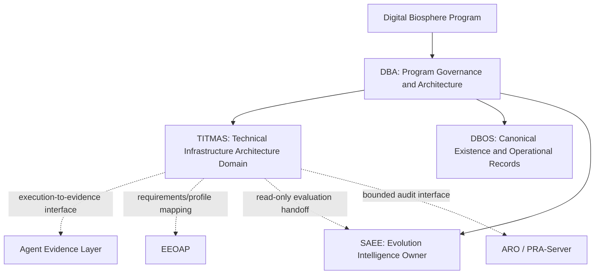

# TITMAS and DBA Relationship v0.1

中文：TITMAS 与 DBA 关系说明 v0.1。

## 1. Document Purpose（文档目的）

本文件冻结 TITMAS（Trusted Infrastructure for Trustworthy Multi-Agent Systems，
可信多智能体系统可信基础设施）与 Digital Biosphere、DBA、DBOS、TMAP、TMAI、
SAEE、EEOAP 和 Agent Evidence Layer（智能体证据层）之间的概念边界。

它是 architecture relationship proposal（架构关系提案），不是 Portfolio Admission
（项目组合准入）、仓库归属决定、实现规范、代码迁移计划或发布授权。

本文件受以下现有规范约束：

- [`../PROGRAM-CHARTER.md`](../PROGRAM-CHARTER.md)：DBA 项目群使命与事实来源；
- [`open-infrastructure-strategy-constitution.md`](open-infrastructure-strategy-constitution.md)：
  开放基础设施最高战略边界；
- [`stack-specification.md`](stack-specification.md)：DBA、DBOS、SAEE 与 Digital Entity 分层；
- [`trusted-multi-agent-protocol-specification.md`](trusted-multi-agent-protocol-specification.md)：
  TMAP 协议对象与可信边界；
- [`architecture-authority-model.md`](architecture-authority-model.md)：Program、Architecture、
  Operational 与 Evolution Authority 分离；
- [`interface-boundary-rules.md`](interface-boundary-rules.md)：支持组件不能建立第二事实权威。

## 2. Canonical Position（规范定位）

TITMAS 是 DBA 体系下的 proposed technical infrastructure architecture domain
（拟议技术基础设施架构域）。它面向可信多智能体系统的跨生态互操作，定义未来
adapter、profile、handoff、provenance 和 conformance 的共同边界。

TITMAS 不是：

- Digital Biosphere 之上的新最高治理层；
- DBA 的替代者或第二个 Program Governance Cockpit（项目群治理驾驶舱）；
- DBOS 的替代 Runtime、Identity、Execution、Evidence 或 Verification 权威；
- TMAP 的重命名或第二套协议权威；
- SAEE 的公共算法服务或演化 Controller（控制器）；
- Agent Framework、Workflow Tool、项目管理系统或治理 Dashboard；
- 把现有仓库移动到一个大目录中的所有权容器。

```text
TITMAS_IS_DBA_SUBDOMAIN=true
TITMAS_IS_STRATEGIC_SUBDOMAIN=true
TITMAS_IS_TECHNICAL_INFRASTRUCTURE_ARCHITECTURE=true
TITMAS_IS_TOP_LEVEL_GOVERNANCE=false
TITMAS_IS_PROGRAM_MANAGEMENT_SYSTEM=false
TITMAS_IS_RUNTIME=false
TITMAS_REPLACES_DBA=false
TITMAS_REPLACES_DBOS=false
TITMAS_REPLACES_TMAP=false
TITMAS_OWNS_SAEE_CORE=false
```

## 3. Three-tier Relationship（三级关系）

用户要求的简化关系如下。箭头表示 architecture routing and constrained
interoperability（架构路由与受约束互操作），不表示仓库所有权、代码包含、权限继承
或 Runtime 调用已经存在。

```text
Digital Biosphere
  -> DBA: program governance + architecture + protocol rules
       -> TITMAS: trusted multi-agent technical infrastructure architecture domain
            -> Agent Evidence Layer: execution-to-evidence material interface
            -> EEOAP: execution-evidence and accountability requirements interface
            -> SAEE: read-only evaluation and evolution interface
```

三级分别是 `Digital Biosphere program`、`DBA governance/architecture` 与 `TITMAS
technical infrastructure architecture domain`。Agent Evidence Layer、EEOAP 和 SAEE 是
第三级连接的责任对端，不是第四级所有权容器。



完整责任图必须保留 DBOS 的规范 Owner 边界：

```text
Digital Biosphere Program
  └─ DBA: Program Governance and Architecture Specification Hub
       ├─ DBOS: canonical existence and operational-record responsibility
       ├─ SAEE: canonical evaluation and evolution-intelligence responsibility
       ├─ TMAP: DBA-maintained open protocol contract, not a project or Runtime
       └─ TITMAS: proposed cross-ecosystem infrastructure architecture domain
            ├─ interoperates with Agent Evidence Layer
            ├─ conforms to or maps EEOAP requirements
            ├─ hands admitted, versioned, read-only inputs to SAEE
            ├─ may connect ARO / PRA-Server through bounded audit interfaces
            └─ maps Microsoft AGT, LangChain, CrewAI, OpenTelemetry and MCP
```

Agent Evidence Layer、EEOAP、SAEE、ARO 和 PRA-Server 在图中是 interface peer or
responsibility owner（接口对端或责任 Owner），不是因为连到 TITMAS 就成为 TITMAS
子项目。精确仓库归属、canonical source 和准入状态必须在下一阶段单独核验。

## 4. DBA and TITMAS Responsibility Split（DBA 与 TITMAS 职责分离）

| 事项 | DBA | TITMAS | 禁止推断 |
|---|---|---|---|
| 总项目使命与战略 | 维护并通过 ADR/Review 改变 | 遵循，不另立最高战略 | TITMAS 可以覆盖 DBA |
| Program Portfolio、Roadmap、Decision、Risk、Gate | 规范 Owner | 作为被治理的架构域提供输入 | TITMAS 是项目管理系统 |
| TMAP 对象含义和架构不变量 | DBA 维护 | 通过 profile/adapter contract 实现映射候选 | TITMAS 创建第二套协议权威 |
| 跨生态 adapter/profile/handoff 架构 | 规定上位边界和审批流程 | 定义技术互操作职责与可替换接缝 | adapter 已实现或生态已采用 |
| Runtime、Identity、Execution、Evidence、Verification | DBA 只定义规则；DBOS 是运行责任域 | 不成为 canonical Owner，只定义交接 | TITMAS 是 DBOS replacement |
| Evaluation、Fitness、Risk、Evolution | DBA 维护跨域边界；SAEE 是评价责任域 | 只定义只读输入/输出接缝 | TITMAS 可调用或公开 SAEE 核心算法 |
| 实现、部署与发布 | 定义 gate；人工明确决定 | 当前无实现、部署或发布效力 | Charter 等于 Authorization |

## 5. Required DBOS Guardrail（必须保留的 DBOS 护栏）

虽然简化关系突出 `TITMAS -> Agent Evidence Layer / EEOAP / SAEE`，但任何未来
实现都不能绕过现有 DBA 不变量：

- DBOS 保持 Identity、Capability record、Execution record、canonical Evidence、
  Verification 和 Lifecycle 的责任域；
- Agent Evidence Layer 或 EEOAP 可以提供 material、profile、receipt、validator result
  或 handoff，但不因 TITMAS 路由自动成为 DBOS canonical Owner；
- ARO / PRA-Server 的 audit、replay 或 verification result 必须保留来源和 scope，不能
  自动升级为 DBOS Verification、Truth、Permission 或 SAEE Fitness；
- TITMAS 不得建立与 DBOS 平行的 `entity_id`、`capability_id`、Evidence store、
  Permission store 或 lifecycle state machine。

```text
OBSERVATION_NE_EVIDENCE=true
EVIDENCE_NE_TRUTH=true
AUDIT_RESULT_NE_CANONICAL_VERIFICATION=true
FRAMEWORK_AGENT_ID_NE_DBOS_ENTITY_ID=true
TITMAS_CANONICAL_EVIDENCE_OWNER=false
```

## 6. Name and Concept Separation（名称与概念分离）

| 名称 | v0.1 含义 | 与 TITMAS 的关系 |
|---|---|---|
| Digital Biosphere | 总项目和长期愿景 | TITMAS 属于该总项目，不高于它 |
| DBA | 项目群治理与架构规范中心 | TITMAS 的架构治理入口和 primary documentation repository |
| TMAI | 已有公开定位 `Trusted Multi-Agent Infrastructure` | 不被 TITMAS 静默重命名或取代 |
| TMAP | Trusted Multi-Agent Protocol，DBA 维护的开放协议契约 | TITMAS 复用并映射，不复制协议语义 |
| DBOS | 可信多智能体存在与运行记录责任域 | TITMAS 不创建第二个 DBOS |
| TITMAS | 可信多智能体系统可信基础设施架构域 | 聚焦跨生态技术互操作与可信交接 |
| TITMAS Infrastructure Developer Community | TITMAS 可信多智能体基础设施开发者社区方向 | 社区名称与路线已采纳；社区、SIG、Maintainer、仓库和公共贡献渠道未建立 |

`TITMAS` 与既有 `TMAI` 名称高度接近。v0.1 只接受 TITMAS 作为 internal architecture
domain name（内部架构域名称）。`ADR-029` 已固定未来社区表面的完整名称必须包含
`Infrastructure`／“基础设施”；这不等于 TITMAS 已经对外建立社区，也不自动决定其更广泛
品牌使用、Portfolio 准入、站点修改或发布术语。后者仍需要单独的 canonical naming
review（规范命名审查）与 ADR。

## 7. Authority and Truth Boundary（权力与事实边界）

| truth or authority surface | canonical responsibility | TITMAS effect |
|---|---|---|
| Program/Architecture rule | DBA + explicit Human Decision | 遵循和引用；不单方面改变 |
| Identity/Capability/Execution/Evidence/Verification/Lifecycle | DBOS responsibility domain | 只定义交接和映射；无写权 |
| EEOAP requirement/profile | 以未来核验的 EEOAP canonical source 为准 | 建立 profile mapping；不重写规范 |
| Evidence material/package | 以未来核验的 Agent Evidence Layer source 为准 | 传递、关联和符合性接缝；不升级为 Truth |
| Audit/replay result | 以未来核验的 ARO/PRA source 为准 | 作为 bounded input；不自带权威提升 |
| Fitness/Risk/Stability/Evolution Recommendation | SAEE | 只读输入输出 contract；无算法所有权 |
| Permission/Authorization/Adoption | 明确授权主体和独立 Decision record | 无自动效果 |

## 8. Change Gate（变更闸门）

本关系说明只能冻结 concept boundary（概念边界）。进入下一阶段前至少需要：

1. 核验每个现有项目的 canonical source、Owner、branch/version 和当前状态；
2. 完成 TITMAS capability map（能力地图）与 duplicate responsibility review（重复职责审查）；
3. 决定 TITMAS 是 `LOGICAL_LAYER`、`ARCHITECTURE_DOMAIN` 还是未来独立 Project；
4. 对 `TMAI` / `TMAP` / `TITMAS` 做命名冲突审查；
5. 由显式 Human Architecture Decision 决定是否采纳；
6. 在另行 Implementation Authorization 前保持无代码、无仓库、无 Runtime。

```text
CONCEPT_BOUNDARY_PROPOSED=true
CONCEPT_BOUNDARY_REVIEW_REQUIRED=true
PORTFOLIO_ADMISSION_DECIDED=false
CANONICAL_NAMING_RECONCILED=false
IMPLEMENTATION_MAPPING_COMPLETE=false
IMPLEMENTATION_AUTHORIZED=false
NEW_REPOSITORY_AUTHORIZED=false
```

详细职责、生态互操作、SAEE 核心保护和未来 GitHub 组织候选见
[`titmas-architecture-charter-v0.1.md`](titmas-architecture-charter-v0.1.md)。
